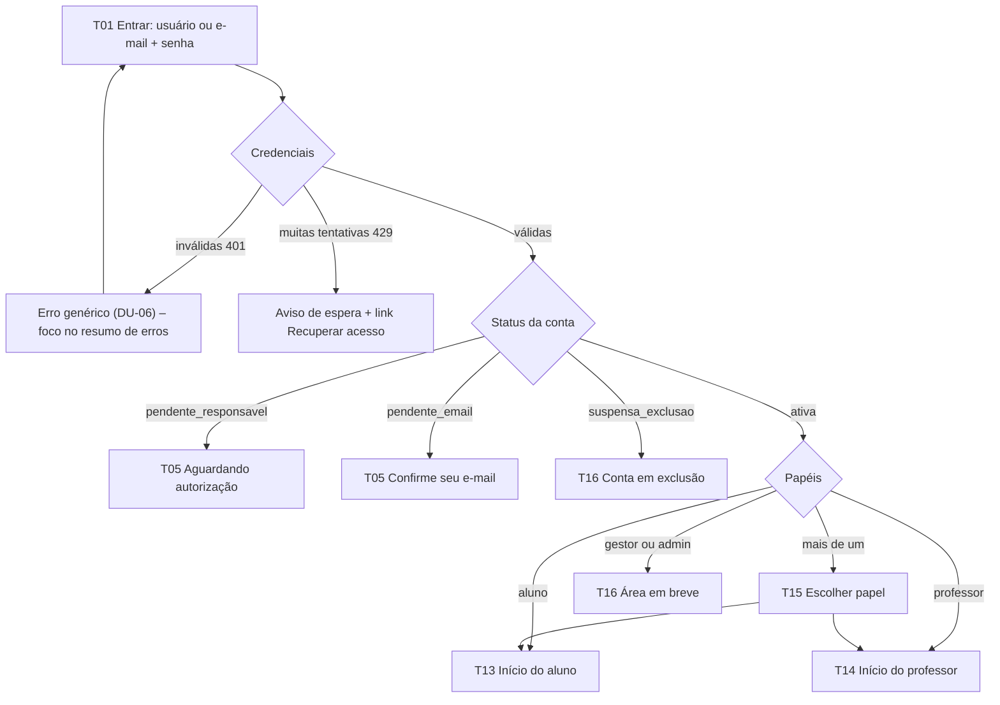
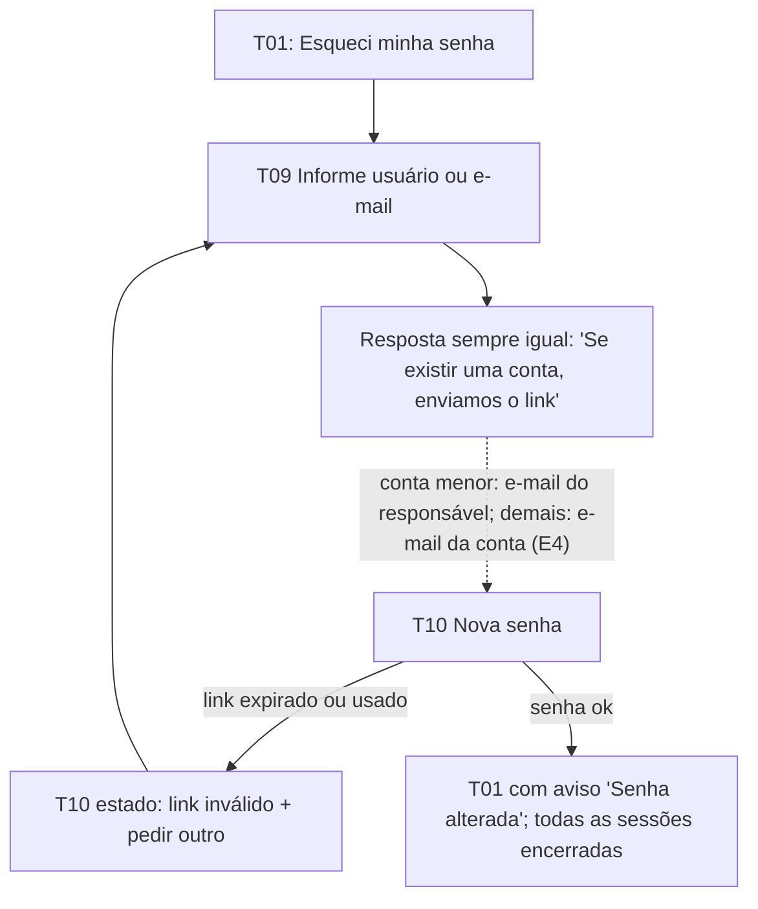
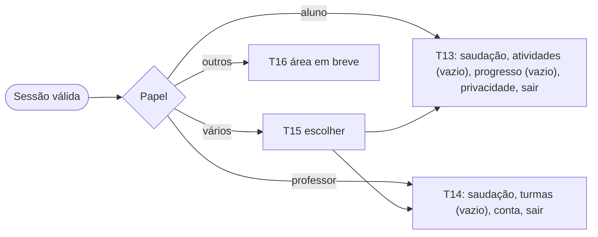

# Fluxos e wireframes — Sprint 1 (v1.0 do contrato)

Dono: UX · Consumidores: FE (S1-FE-01/02), BE-02, PED-02, QA · Tokens: `tokens.json` · Princípios/tom: `principios.md` · Requisitos: `docs/seguranca/lgpd-requisitos.md` (RQ-nn).
Wireframes são **mobile (360px)**, caracteres ASCII. Desktop (≥768px): o mesmo conteúdo em cartão centralizado (formulários `formMax` 440px); homes em grade de cartões. `[ ]` campo · `( )` opção · `[x]` marcado · `[ Botão ]` ação · `<link>` link · `!` mensagem de erro.

## 1. Índice de telas
| ID | Tela | Quem | Rota sugerida |
|---|---|---|---|
| T01 | Entrar | todos | `/entrar` |
| T02 | Cadastro de aluno — passo 1 "Sobre você" | aluno | `/cadastro` |
| T03 | Cadastro — passo 2 "Responsável" (< 18) ou "Seu e-mail" (≥ 18) | aluno | `/cadastro` |
| T04 | Cadastro — passo 3 "Senha" | aluno | `/cadastro` |
| T05 | Aguardando autorização / confirme seu e-mail | aluno | `/cadastro/aguardando` |
| T06 | Autorizar uso (página do responsável, via link) | responsável | `/responsavel/autorizar?t=…` |
| T07 | Resultado da autorização (autorizado / recusado / link inválido) | responsável | mesma rota |
| T08 | Gerenciar autorização e revogar (via link do e-mail) | responsável | `/responsavel/gerenciar?t=…` |
| T09 | Recuperar acesso — pedido | todos | `/recuperar` |
| T10 | Recuperar acesso — nova senha (via link) | aluno/resp./prof. | `/recuperar/nova?t=…` |
| T11 | Cadastro de professor (via convite) | professor | `/professor/cadastro?t=…` |
| T12 | Resultado da confirmação de e-mail | ≥ 18 / professor | `/confirmar-email?t=…` |
| T13 | Início do aluno | aluno | `/aluno` |
| T14 | Início do professor | professor | `/professor` |
| T15 | Escolher papel (usuário com mais de um) | todos | `/papel` |
| T16 | Estados globais (sessão expirada, sem acesso, erro, sem conexão, área em breve) | todos | — |

Tokens de link (`t=`) vão na URL só enquanto necessário e a página os troca por estado interno e limpa a URL (RQ-32: sem PII em URL; o token em si não é PII).

## 2. Decisões de UX propostas (BE-02/SEG/PED confirmam)
- **DU-01 Apelido = usuário de login, sempre gerado** (adjetivo + animal + número, ex.: `LeaoAzul42`; botão "Sortear outro"). O aluno não digita nome livre: zero risco de dado pessoal/palavrão (RQ-22) e nada para o Fund. I escrever. Consequência: o apelido (público no ranking futuro) é também o login; a senha é o segredo; rate limit é requisito (SEG).
- **DU-02 Responsável não tem conta no Sprint 1**: age por link de uso único enviado ao e-mail (T06, T08). Papel `responsavel` com login fica para versão futura.
- **DU-03 Recuperação de acesso do menor** vai para o **e-mail do responsável**; o responsável define a nova senha (T10) com o aluno ao lado.
- **DU-04 Professor só por convite** (ADR-001 §4); o convite é emitido fora das telas do Sprint 1 (seed/admin).
- **DU-05 Senha**: mín. 8 caracteres, sem exigir símbolo, bloquear senhas muito comuns, colar permitido, botão "Mostrar", botão "Sugerir senha" (3 palavras, ex.: `bola-nuvem-sete`).
- **DU-06 Mensagens que não revelam se a conta existe** (login, recuperação). O status "aguardando responsável" só aparece depois de usuário+senha corretos.
- **DU-07 Data de nascimento neutra**: pergunta de idade sem aviso prévio de que "menores precisam de autorização", para não induzir resposta falsa. Só mês/ano (RQ-02).

## 3. Estados da conta

```mermaid
stateDiagram-v2
    [*] --> pendente_responsavel: cadastro < 18
    [*] --> pendente_email: cadastro ≥ 18 / professor
    pendente_responsavel --> ativa: responsável autoriza (T06)
    pendente_responsavel --> apagada: recusa (T06) ou 7 dias sem resposta (RQ-05)
    pendente_email --> ativa: confirma e-mail (T12)
    pendente_email --> apagada: sem confirmação no prazo
    ativa --> suspensa_exclusao: responsável revoga (T08) / pedido de exclusão
    suspensa_exclusao --> apagada: até 15 dias (RQ-14)
    apagada --> [*]
```


## 4. Fluxo — cadastro de aluno < 18 com consentimento do responsável
```mermaid
flowchart TD
    A([Landing / T01 Entrar: "Criar conta"]) --> B["T02 Sobre você: apelido sorteado, mês/ano de nascimento, ano escolar"]
    B --> C{Idade calculada}
    C -->|menor de 18| D["T03 E-mail do responsável"]
    C -->|18 ou mais| D2["T03 Seu e-mail"]
    D --> E["T04 Senha + aviso para estudantes"]
    D2 --> E
    E --> F{Enviar}
    F -->|erro de validação 400| E
    F -->|muitas tentativas 429| E
    F -->|ok, menor| G["T05 Aguardando autorização\n(conta pendente_responsavel)"]
    F -->|ok, 18+| G2["T05 Confirme seu e-mail\n(conta pendente_email)"]
    G -. "e-mail E1 com link" .-> H["T06 Responsável lê e decide"]
    H -->|Autorizar| I["T07 Autorizado\n(e-mail E2 com link de gerenciar)"]
    H -->|Não autorizar| J["T07 Recusado: cadastro apagado"]
    H -->|link expirado ou usado| K["T07 Link inválido"]
    I --> L["Aluno entra: T01 → T13"]
    G2 -. "e-mail E3" .-> M["T12 E-mail confirmado"] --> L
    G -->|Reenviar / corrigir e-mail| G
    G -->|7 dias sem resposta| N["Pré-cadastro apagado (RQ-05)"]
```
Regras: o aluno **não entra** enquanto `pendente_*`. Antes do consentimento coleta-se só o mínimo para pedi-lo (RQ-03). T05 oferece reenviar (limite de frequência, `RATE_LIMITED`) e corrigir o e-mail do responsável (renova o link, invalida o anterior).

## 5. Fluxo — login

Logout está sempre no menu do cabeçalho; sessão expirada leva a T16 "Sua sessão acabou" com botão para T01, preservando a rota de destino.

## 6. Fluxo — recuperação de acesso

Link de uso único e curto (premissa 1 h; BE/SEG definem). No caso de menor, T10 mostra "Anote a nova senha e conte para [apelido]".

## 7. Fluxo — visão inicial por papel

O papel nunca vem do cookie; a UI lê `/me` e esconde o que não pode, mas a barreira é o servidor (RQ-35). Aplicar `data-etapa` (tokens) a partir do ano escolar do aluno.

## 8. Wireframes

### T01 Entrar
```
+--------------------------------------+
|  [logo] Aprende+                     |
|                                      |
|  Entrar                       (h1)   |
|  Use seu apelido ou e-mail.          |
|                                      |
|  ! Usuário ou senha incorretos.      |  <- resumo (role=alert), foco aqui
|                                      |
|  Usuário ou e-mail                   |
|  [______________________________]    |
|  Senha                               |
|  [____________________] [ Mostrar ]  |
|                                      |
|  [          Entrar               ]   |
|  <Esqueci minha senha>               |
|  ----------------------------------  |
|  Primeira vez aqui?                  |
|  [   Criar conta de aluno        ]   |
|  <Sou professor: tenho um convite>   |
+--------------------------------------+
```
Campos: usuário/e-mail `autocomplete="username"`, senha `autocomplete="current-password"`. Estados: carregando (botão desabilitado + "Entrando…"), 401 genérico, 429 "Muitas tentativas. Espere alguns minutos e tente de novo.", sem conexão.

### T02 Cadastro — passo 1 "Sobre você"
```
+--------------------------------------+
|  [<] Criar conta                     |
|  Passo 1 de 3  [=====-----------]    |
|                                      |
|  Sobre você                   (h1)   |
|                                      |
|  Seu apelido                         |
|  [ LeaoAzul42        ] [ Sortear ]   |
|  Esse nome aparece para você e       |
|  é com ele que você entra.           |
|                                      |
|  Quando você nasceu?                 |
|  Mês [ Selecione v ]  Ano [ Sel. v ] |
|                                      |
|  Em que ano você estuda?             |
|  [ Selecione v ]                     |
|                                      |
|  [          Continuar            ]   |
+--------------------------------------+
```
Selects nativos. Ano escolar: 1º–9º ano do Fundamental; 1ª–3ª série do Médio. Erro: "Escolha o mês e o ano em que você nasceu." Apelido nunca editável livremente (DU-01).

### T03 Cadastro — passo 2 (menor de 18: "Responsável")
```
+--------------------------------------+
|  [<] Criar conta                     |
|  Passo 2 de 3  [==========------]    |
|                                      |
|  Seu responsável               (h1)  |
|  Vamos pedir a autorização de um     |
|  adulto responsável por você.        |
|                                      |
|  E-mail do responsável               |
|  [______________________________]    |
|  ! Escreva um e-mail válido.         |
|  Só usamos este e-mail para a        |
|  autorização e avisos da sua conta.  |
|                                      |
|  [          Continuar            ]   |
+--------------------------------------+
```
Variante **18+** (mesmo passo, título "Seu e-mail", texto "Enviaremos um link para confirmar."): campo `E-mail`, `autocomplete="email"`. Não pedir o nome do responsável aqui (ele informa em T06).

### T04 Cadastro — passo 3 "Senha"
```
+--------------------------------------+
|  [<] Criar conta                     |
|  Passo 3 de 3  [================]    |
|                                      |
|  Crie sua senha                (h1)  |
|                                      |
|  Senha                               |
|  [____________________] [ Mostrar ]  |
|  Mínimo de 8 caracteres.             |
|  [ Sugerir uma senha fácil ]         |
|                                      |
|  [x] Li o aviso de privacidade para  |
|      estudantes. <Ler o aviso>       |
|                                      |
|  [        Criar minha conta      ]   |
+--------------------------------------+
```
`autocomplete="new-password"`. "Ler o aviso" abre Modal com o texto do aluno (PED-02), focável e fechável por Esc. Erros do servidor: `CONFLICT` (apelido já usado → sorteia outro e avisa), `VALIDATION_ERROR` por campo, `RATE_LIMITED`. Idempotência: o botão envia com `Idempotency-Key`; duplo clique não duplica.

### T05 Aguardando autorização (menor) / Confirme seu e-mail (18+ e professor)
```
+--------------------------------------+
|  [logo] Aprende+                     |
|                                      |
|  Falta pouco!                  (h1)  |
|  Enviamos um pedido de autorização   |
|  para ma***@gmail.com.               |
|                                      |
|  Seu apelido para entrar:            |
|  +--------------------------------+  |
|  |  LeaoAzul42        [ Copiar ]  |  |
|  +--------------------------------+  |
|  Quando seu responsável autorizar,   |
|  você já pode entrar.                |
|  O pedido vale por 7 dias.           |
|                                      |
|  [  Reenviar e-mail  ]               |
|  <E-mail errado? Corrigir>           |
|  <Já foi autorizado? Entrar>         |
+--------------------------------------+
```
Variante e-mail próprio: "Enviamos um link para confirmar seu e-mail" (sem apelido em destaque para professor; "Reenviar" e "Corrigir e-mail" iguais). Mostrar o e-mail mascarado. "Reenviado!" em `aria-live`. Limite de reenvios: mensagem "Espere um pouco para pedir de novo." (429).

### T06 Autorizar uso (responsável)
```
+--------------------------------------+
|  [logo] Aprende+                     |
|                                      |
|  LeaoAzul42 quer usar o        (h1)  |
|  Aprende+                            |
|  Precisamos da sua autorização.      |
|                                      |
|  O que guardamos                     |
|   + apelido, mês e ano de nascimento |
|   + ano escolar                      |
|   + progresso nas atividades         |
|  O que NÃO fazemos                   |
|   x pedir CPF, endereço ou foto      |
|   x mostrar anúncios                 |
|   x vender ou compartilhar dados     |
|  Você pode mudar de ideia quando     |
|  quiser, por este e-mail.            |
|  <Aviso de privacidade completo>     |
|                                      |
|  Seu nome                            |
|  [______________________________]    |
|                                      |
|  [ ] Sou responsável por LeaoAzul42  |
|      e autorizo o uso desses dados.  |
|  +--------------------------------+  |
|  | Ranking (opcional)             |  |
|  | [ ] Mostrar o apelido no       |  |
|  |     ranking da turma e escola  |  |
|  +--------------------------------+  |
|                                      |
|  [   Autorizar   ] [ Não autorizar ] |
+--------------------------------------+
```
Os dois botões têm o mesmo peso visual (RQ-08: sem padrão manipulativo); "Autorizar" fica desabilitado até marcar a caixa obrigatória e informar o nome, com a razão em texto. Ranking começa **desmarcado** (RQ-21) e só aparece se o recurso existir na versão (Sprint 1: ocultar o bloco, manter o espaço no layout para v0.x).

### T07 Resultado da autorização
```
 Autorizado                          Recusado
+-----------------------------+    +-----------------------------+
| (ok) Tudo certo!      (h1)  |    | Tudo bem.             (h1)  |
| LeaoAzul42 já pode entrar.  |    | Apagamos o cadastro de      |
| Enviamos um e-mail com o    |    | LeaoAzul42 e este e-mail.   |
| link para mudar de ideia    |    | Nenhum dado foi guardado.   |
| quando quiser.              |    |                             |
| [ Gerenciar autorização ]   |    | [   Ir para o início   ]    |
+-----------------------------+    +-----------------------------+

 Link inválido ou expirado
+-----------------------------+
| (!) Este link não funciona  |
| Ele pode ter expirado ou já |
| ter sido usado. O cadastro  |
| não autorizado em 7 dias é  |
| apagado.                    |
| Peça para o aluno criar a   |
| conta de novo.              |
| [   Ir para o início   ]    |
+-----------------------------+
```

### T08 Gerenciar autorização (responsável)
```
+--------------------------------------+
|  [logo] Aprende+                     |
|                                      |
|  Autorização de LeaoAzul42     (h1)  |
|  Autorizada em 22/10/2026.           |
|                                      |
|  [x] Aparecer no ranking (apelido)   |
|      (opcional)                      |
|                                      |
|  Retirar a autorização               |
|  A conta fica bloqueada agora e os   |
|  dados são apagados em até 15 dias.  |
|  [ Retirar autorização ]  (perigo)   |
|  <Aviso de privacidade completo>     |
+--------------------------------------+
```
"Retirar" abre Modal de confirmação ("Retirar a autorização de LeaoAzul42? Isso não pode ser desfeito." [Retirar] [Voltar]; foco inicial em Voltar). Revogar é tão fácil quanto conceder (RQ-07): 1 clique + 1 confirmação, sem login. Pós-ação: tela de confirmação com protocolo.

### T09 Recuperar acesso — pedido
```
+--------------------------------------+
|  [<] Entrar                          |
|  Recuperar acesso              (h1)  |
|  Informe seu apelido ou e-mail.      |
|  Enviaremos um link para o e-mail    |
|  da conta. Se você é menor de 18,    |
|  o link vai para seu responsável.    |
|                                      |
|  Apelido ou e-mail                   |
|  [______________________________]    |
|  [      Enviar link              ]   |
|                                      |
|  (apos enviar, mesma tela:)          |
|  (ok) Se existir uma conta, o link   |
|  já está a caminho.                  |
+--------------------------------------+
```

### T10 Nova senha
```
+--------------------------------------+
|  Criar nova senha              (h1)  |
|  Para LeaoAzul42  (só menor de 18)   |
|                                      |
|  Nova senha                          |
|  [____________________] [ Mostrar ]  |
|  [ Sugerir uma senha fácil ]         |
|                                      |
|  [      Salvar nova senha        ]   |
|  Anote a senha e conte para          |
|  LeaoAzul42. (só menor de 18)        |
+--------------------------------------+
```
Link inválido: mesmo layout de T07 "Link inválido" com botão "Pedir outro link" (→ T09).

### T11 Cadastro de professor (convite)
```
+--------------------------------------+
|  [logo] Aprende+                     |
|  Bem-vindo(a), professor(a)    (h1)  |
|  Você recebeu um convite da escola   |
|  Nome da Escola.                     |
|                                      |
|  Seu nome                            |
|  [______________________________]    |
|  E-mail institucional                |
|  [ prof@escola.pe.gov.br  ] (fixo)   |
|  Senha                               |
|  [____________________] [ Mostrar ]  |
|  Mínimo de 8 caracteres.             |
|                                      |
|  [x] Li o aviso de privacidade para  |
|      professores. <Ler o aviso>      |
|  [      Criar minha conta        ]   |
+--------------------------------------+
```
E-mail vem do convite e não é editável. Convite inválido/expirado: estado como T07 "Link inválido" com "Fale com a sua escola".

### T12 Resultado da confirmação de e-mail
```
 Confirmado                          Link inválido
+-----------------------------+    +-----------------------------+
| (ok) E-mail confirmado (h1) |    | (!) Este link não funciona  |
| Sua conta está ativa.       |    | Peça um novo link.          |
| [        Entrar        ]    |    | [ Reenviar link ] (→ T05)   |
+-----------------------------+    +-----------------------------+
```

### T13 Início do aluno
```
+--------------------------------------+
| [logo]                  LeaoAzul42 v |   menu: Privacidade, Sair
|--------------------------------------|
|  Oi, LeaoAzul42!              (h1)   |
|  Que bom ver você por aqui.          |
|                                      |
|  +--------------------------------+  |
|  | Suas atividades                |  |
|  | (ilustração)                   |  |
|  | As primeiras atividades        |  |
|  | chegam em breve.               |  |
|  +--------------------------------+  |
|  +--------------------------------+  |
|  | Seu progresso                  |  |
|  | Quando você fizer atividades,  |  |
|  | seu progresso aparece aqui.    |  |
|  +--------------------------------+  |
+--------------------------------------+
```
Sem ranking nem pontuação no Sprint 1. Tom por `data-etapa` (ver `principios.md`); Fund. I usa ícones grandes com rótulo e `fontBase` 18. Reservar espaço para cartões futuros (atividades recomendadas, conquistas, ranking opt-in). Desktop: 2 colunas.

### T14 Início do professor
```
+--------------------------------------+
| [logo]               Profa. Ana  v   |   menu: Minha conta, Privacidade, Sair
|--------------------------------------|
|  Olá, Profa. Ana             (h1)    |
|  Escola Nome da Escola               |
|                                      |
|  +--------------------------------+  |
|  | Minhas turmas                  |  |
|  | Você ainda não tem turmas.     |  |
|  | Em breve você poderá criar     |  |
|  | turmas e atividades aqui.      |  |
|  +--------------------------------+  |
|  +--------------------------------+  |
|  | Sua conta                      |  |
|  | prof@escola.pe.gov.br          |  |
|  | Papel: professor               |  |
|  +--------------------------------+  |
+--------------------------------------+
```
Tom profissional. Desktop: navegação superior com espaço para Turmas, Atividades, Relatórios (ocultos até existirem).

### T15 Escolher papel
```
+--------------------------------------+
|  Como você quer entrar?        (h1)  |
|  +--------------------------------+  |
|  | Aluno                       >  |  |
|  +--------------------------------+  |
|  | Professor                   >  |  |
|  +--------------------------------+  |
+--------------------------------------+
```
Cartões são botões/links de ≥ 44px. A escolha fica na sessão; menu tem "Trocar papel".

### T16 Estados globais
```
 Sessão acabou        Sem acesso (403/404)   Erro (500)            Sem conexão
+---------------+    +---------------+      +---------------+     +---------------+
| Sua sessão    |    | Você não tem  |      | Algo deu      |     | Sem internet. |
| acabou.       |    | acesso a esta |      | errado. Não   |     | Tentaremos de |
| [ Entrar ]    |    | página.       |      | foi culpa     |     | novo quando   |
+---------------+    | [ Ir p/ início]     | sua.          |     | voltar.       |
                     +---------------+      | [Tentar de novo]    | [Tentar agora]|
                                            | cód. req: 01H…|     +---------------+
                                            +---------------+
 Área em breve (gestor/admin): "Sua área está chegando. Por enquanto, [ Sair ]."
 Conta em exclusão: "Esta conta está sendo apagada. Dúvidas: <canal do encarregado>."
```
404 e 403 usam o mesmo texto (não revelar existência, ADR §3). Erro 500 mostra o `X-Request-Id` para suporte, nunca detalhe técnico (RQ-32).

## 9. Formulários — regras comuns
- Validação ao sair do campo e ao enviar; no envio com erro, **resumo de erros** no topo (`role="alert"`, foco nele) com links para cada campo; erro em texto + ícone.
- Erros do servidor `{ok:false, error:{code, details:[{path,code}]}}` mapeiam para campo por `path`; `code` sem `path` vai ao resumo. Mensagens são do catálogo pt-BR do FE, não o texto cru da API.
- Botão de envio desabilitado só durante o envio (nunca por validação oculta); mostra texto de progresso.
- Nada de limite de tempo; rascunho do cadastro mantido em memória ao voltar entre passos (não em `localStorage`; sem dados de menores guardados no navegador).

| Código da API | Mensagem ao usuário (tom neutro) |
|---|---|
| `VALIDATION_ERROR` | Mensagem do campo (ex.: "Escreva um e-mail válido.") |
| `UNAUTHENTICATED` (login) | "Usuário ou senha incorretos." |
| `RATE_LIMITED` | "Muitas tentativas. Espere alguns minutos e tente de novo." |
| `CONFLICT` | Cadastro: "Esse apelido já existe. Vamos sortear outro." |
| `FORBIDDEN` / `NOT_FOUND` | "Você não tem acesso a esta página." |
| `INTERNAL` / rede | "Algo deu errado. Tente de novo." (+ id da requisição) |

## 10. E-mails transacionais (conteúdo final: PED-02)
| ID | Para | Quando | Assunto / CTA |
|---|---|---|---|
| E1 | Responsável | Fim do cadastro de menor | "Autorize o uso do Aprende+ por [apelido]" · botão "Ver e decidir" (7 dias) |
| E2 | Responsável | Após autorizar | "Autorização registrada" · link "Gerenciar autorização" (T08) |
| E3 | Aluno 18+ / professor | Fim do cadastro | "Confirme seu e-mail" · botão "Confirmar" |
| E4 | E-mail da conta (responsável se menor) | Pedido de recuperação | "Crie uma nova senha" · botão "Criar nova senha" (T10) |
Todos em texto simples + HTML mínimo, sem imagens de rastreamento, sem PII no assunto além do apelido; link único e botão com texto legível também em texto puro.

## 11. Pendências para outros especialistas
- **BE-02:** modelar apelido gerado como login (DU-01), link de gerenciar do responsável (T08, sem conta), TTL e limite de reenvio dos links, nome do responsável gravado no consentimento.
- **SEG:** confirmar DU-01/03/06, política de rate limit/Turnstile em T01, T04, T05, T09 e TTL do link de recuperação.
- **PED-02:** textos dos avisos (aluno, responsável, professor), corpos dos e-mails E1–E4 e frases de T06/T07/T08.
- **FE:** `data-etapa` só na área logada; telas públicas em `neutra`.
